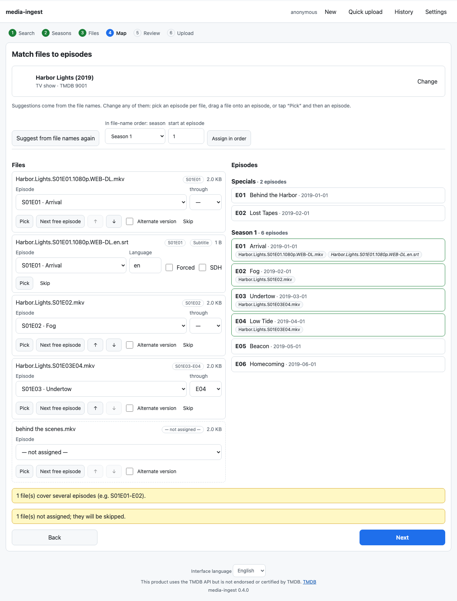
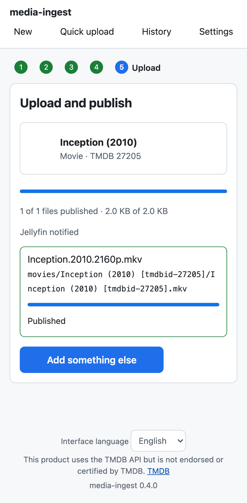
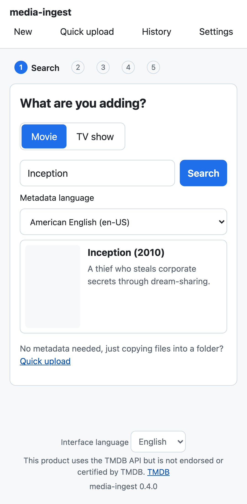
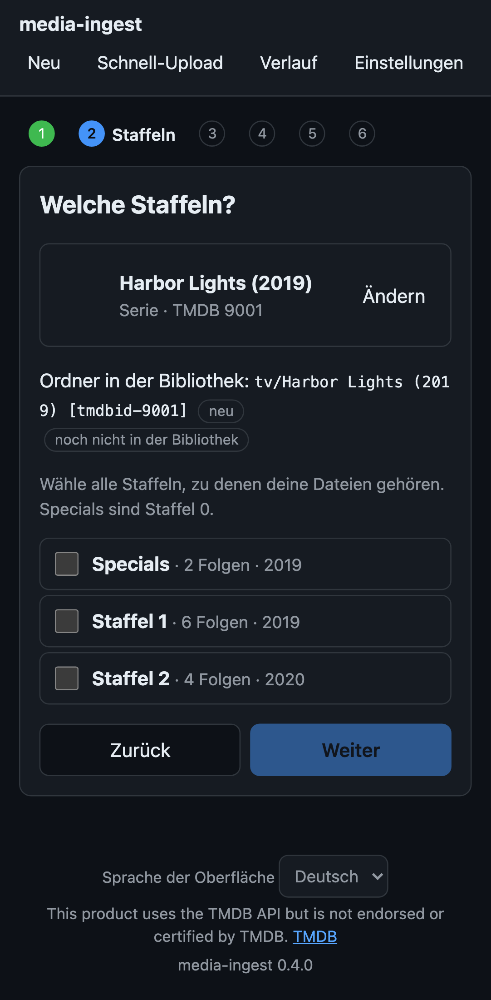
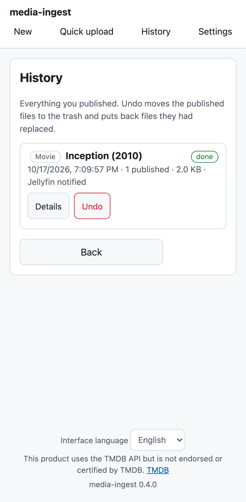
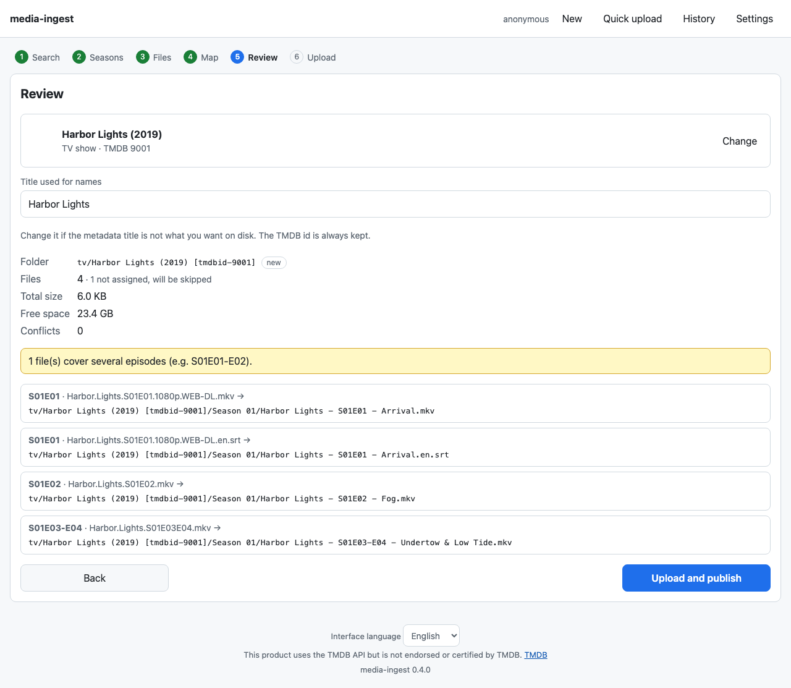

# media-ingest

[](https://github.com/configtheworld/media-digest/actions/workflows/ci.yml)
[](https://github.com/configtheworld/media-digest/actions/workflows/security.yml)
[](LICENSE)

Self-hosted web app that files your **movies and TV episodes** into a Jellyfin, Plex or Emby library.
Pick the title from TMDB, drop your files from a phone or a desktop browser, check the exact final
paths, upload. The app does all the naming — you never rename files on your devices.

<p>
  
  
</p>

## Features

- **Movies and TV shows** from TMDB (any metadata language): seasons and specials, file-to-episode
  mapping suggested from file names, drag and drop on desktop, tap to assign on touch, multi-episode
  files, alternate versions, movie versions, extras and subtitles.
- **Library awareness**: shows what is already in your library, reuses existing folders, never
  duplicates or overwrites without asking (skip, replace to trash, keep both).
- **Safe publishing**: resumable uploads (tus) into a staging folder, then one atomic move per file —
  the media server never sees partial or misnamed files. Files get your owner and permissions.
- **History with undo**, an optional **Jellyfin** library hook, **quick upload** for files without metadata.
- **Episode name rules** in English, Turkish, German and Spanish, extendable with YAML.
- **Naming presets** for Jellyfin, Plex and Emby, or your own templates.
- Works behind **Authelia** (or any auth proxy) or with a built-in login; installable as a **PWA**;
  UI in English, German, Turkish and Spanish; light and dark; keyboard and screen-reader friendly.
- One small container (≈14 MB, amd64 and arm64), non-root, read-only, configured by environment variables.

## Quick start

```sh
git clone https://github.com/configtheworld/media-digest.git && cd media-digest
cp .env.example .env && chmod 600 .env   # set MEDIA_PATH, PUID/PGID, TRUSTED_PROXIES, TMDB_API_KEY
mkdir -p data && chown 1000:1000 data    # the PUID:PGID from .env
docker compose up -d --build             # or use image ghcr.io/configtheworld/media-digest:latest
docker compose logs -f                   # wait for "listening"
```

Put it behind your reverse proxy (it must pass the signed-in user as `Remote-User`) and open it.
Without `TMDB_API_KEY` an admin enters the key once in the browser. Update with
`git pull && docker compose up -d --build`.

Full guides: **[deployment](docs/deployment.md)** · **[reverse proxies](docs/reverse-proxy.md)** ·
**[configuration reference](docs/configuration.md)**.

## Documentation

| Guide | Covers |
|---|---|
| [Deployment](docs/deployment.md) | compose, docker run, volumes, permissions, unprivileged LXC |
| [Reverse proxies](docs/reverse-proxy.md) | Traefik + Authelia, Nginx, Caddy, large uploads, Cloudflare |
| [Configuration](docs/configuration.md) | every environment variable, Jellyfin hook, commands |
| [Naming](docs/naming.md) | presets, templates, versions, extras, subtitles, sanitizing |
| [Episode rules](docs/parser-rules.md) | how file names are parsed, writing a rule pack |
| [Troubleshooting](docs/troubleshooting.md) | sign-in, permissions, uploads, Jellyfin |
| [Architecture](docs/architecture.md) | how a batch flows through the code |

## How files are published

1. You choose the title (and seasons), add files and review the plan. Nothing is uploaded or written
   before you confirm; the review shows every final path, conflicts and free space.
2. Files are uploaded in 8 MiB chunks to `<MEDIA_ROOT>/.incoming` (outside the libraries). Uploads
   resume after network loss, phone sleep or a page reload.
3. Each finished file is fsynced, given its permissions, and linked to its final name in one atomic
   step that fails instead of overwriting. Replaced files go to `.trash`, and **Undo** puts them back.

```
movies/Inception (2010) [tmdbid-27205]/Inception (2010) [tmdbid-27205].mkv
tv/Dark (2017) [tmdbid-70523]/Season 01/Dark - S01E02 - Lies.mkv
```

## Screenshots

| Search (phone) | Seasons (dark, German) | History | Review |
|---|---|---|---|
|  |  |  |  |

## Security

The app writes to your library, so it fails closed: the auth header is accepted only from your proxy,
every path is built on the server and confined to `MEDIA_ROOT`, nothing is overwritten or deleted
silently, and state-changing requests need a CSRF token. Details and how to report a vulnerability:
[SECURITY.md](SECURITY.md).

## Contributing

Bug reports, translations and rule packs for more languages are very welcome — see
[CONTRIBUTING.md](CONTRIBUTING.md). Changes are listed in the [changelog](CHANGELOG.md).

## Attribution and license

This product uses the TMDB API but is not endorsed or certified by TMDB.

[MIT](LICENSE) © media-ingest contributors
